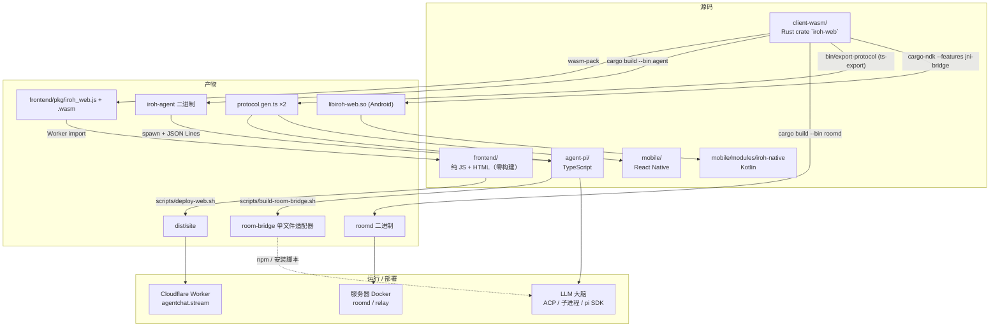
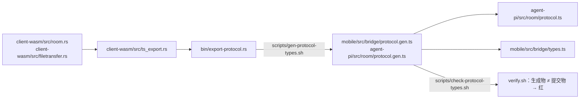
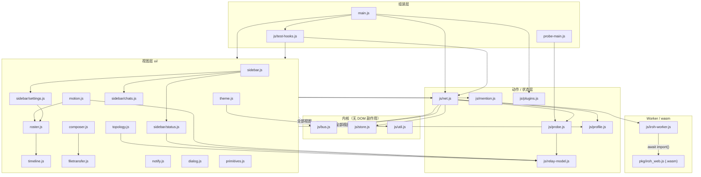
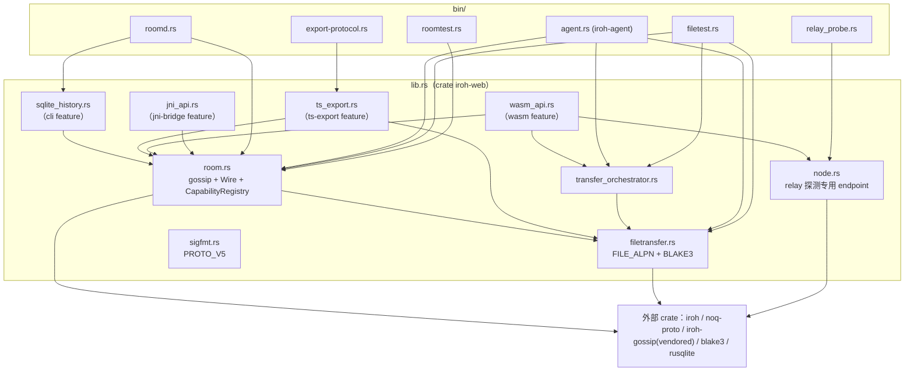
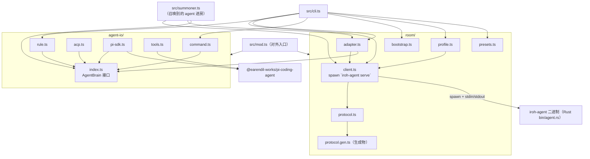
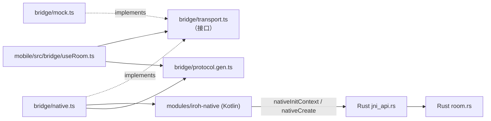

# 依赖关系图

> **口径**：本文件画的是**代码依赖**（谁 import / use 谁）与**产物依赖**（谁 spawn / 加载谁）。
> 运行时"谁连谁"的拓扑图不在这里，见 [architecture-refactor-plan.md §11](architecture-refactor-plan.md)
> 的 `architecture-2026-10-11.png`。两者互补：架构图回答"房间里有谁"，本图回答"改一个文件会牵动谁"。
>
> 图由实际 import / use 扫描得出（扫描方式见文末），不是凭印象画的。

---

## 1. 全局：源码 → 产物 → 运行



**要点**：`client-wasm`（Rust）是整张图的**根**——wasm、两个 native 二进制、三端协议类型
全部从它派生。前端是**零构建**的，所以前端唯一的"构建产物依赖"就是那份 wasm。

---

## 2. 协议单一来源链（最需要守住的一条边）



前端是纯 JS、没有类型系统，所以它拿不到这条链的约束，改用等价检查：
`scripts/check-web-event-names.mjs` 断言 `net.js` 里 `case` 的事件名都真实存在于 `protocol.gen.ts`。

---

## 3. frontend/ 模块依赖（按层，非逐边）



### 边界规则与现状

README「组装与依赖边界」定的两条规矩，以及目前的实际执行情况：

| 规则 | 是否有工具强制 | 现状 |
|---|---|---|
| 视图不得**反向依赖 `main`** | ❌ 靠约定 | ✅ 干净：无任何 view → main.js 的 import |
| 视图不得**导入另一个视图的门面** | ❌ 靠约定 | ⚠️ 有 4 条：`composer→filetransfer`、`motion→roster`、`settings→roster`、**`roster→timeline`** |
| 相对 import 的目标文件必须存在 | ✅ `scripts/check-site-modules.py` | 绿（但它**只查存在性，不查方向**） |

值得注意的一条：`roster.js` 直接读 `timeline._recent` / `timeline.room` / `timeline.me`
（下划线私有字段），这是"名册页要拿本次会话的历史窗口"。方向是**新视图 → 旧视图的状态**，
不是循环依赖，但确实越过了 README 里说的门面边界。

---

## 4. client-wasm/ Rust 模块依赖



`iroh-gossip` 被 `[patch.crates-io]` 指到本仓库的 `vendor/iroh-gossip`
（改过上游代码，所以这是**源码依赖、不是版本依赖**，升级 iroh 时要注意）。

---

## 5. agent-pi/ TypeScript 模块依赖



**两个"跨语言"的边**，是这张图里最容易断的地方：
`client.ts → iroh-agent`（行协议 + `IPC_VERSION`）与 `protocol.gen.ts`（版本串必须与 Rust 一致）。
协议 bump 时，`iroh-agent` 二进制、`protocol.gen.ts`、`IPC_VERSION` 三者要同窗口换完。

---

## 6. mobile/ 与 Kotlin 桥



> `nativeInitContext` 必须被调用，否则 Android 直接 SIGABRT（见 `Cargo.toml` 注释）。

---

## 7. 扫描方式（图变了就重跑）

```bash
# 前端 import 图
rg -n "^import .* from ['\"]\." frontend --glob '*.js'
# Rust 模块依赖
rg -n "^(use crate|mod|pub mod) " client-wasm/src --glob '*.rs'
# agent-pi / mobile 的 TS import
rg -n "from ['\"]\." agent-pi/src mobile/src --glob '*.ts'
# 校验链（谁在强制这些边）
sed -n '1,40p' scripts/verify.sh
```
